<p align="center">
  
</p>

<p align="center">
  
</p>

<p align="center">
  <a href="https://www.linkedin.com/in/alex-mathew"></a>
  <a href="mailto:alexut451@gmail.com"></a>
  <a href="https://github.com/Alexm2025?tab=repositories"></a>
  
  
</p>

---

## 👨‍💻 About me

<table>
<tr>
<td width="55%" valign="top">

I'm a **3rd-year Computer Engineering student** at **Fr. C. Rodrigues Institute of Technology, Vashi**, and I like building software that real people actually use.

- 🛡️ Right now: building **AgentGuard**, a runtime security layer that stops prompt-injection attacks on AI agents
- 🏆 Led teams at **Smart India Hackathon 2026** and **HACK ON TRACK 2026** (First Runner-Up)
- 🌐 Shipped a live production website for an HR services company
- 📝 Assistant Documentation Head, **CSI FCRIT**
- 🤝 Looking for **internships** in backend, full-stack, Android or AI security

</td>
<td width="45%" valign="top">

```python
class Alex:
    college  = "FCRIT, Vashi"
    branch   = "Computer Engineering"
    based_in = "Mumbai, India"

    focus = ["AI security", "Full-stack",
             "Android", "Blockchain"]

    def now(self):
        return "Shipping AgentGuard 🛡️"

    def next(self):
        return "Your internship? 👀"
```

</td>
</tr>
</table>

## 🏆 Achievements

<table>
<tr>
<td width="33%" valign="top" align="center">
<h3>🇮🇳 SIH 2026</h3>
<b>Team Leader · Team JustWeMet</b><br><br>
Nominated by FCRIT for Smart India Hackathon 2026 with <a href="https://github.com/Alexm2025/KATHA"><b>KATHA</b></a>, an AI tool that translates Hindi lessons into Ho, Mundari and Santhali, with offline support on low-cost tablets.
</td>
<td width="33%" valign="top" align="center">
<h3>🥈 HACK ON TRACK 2026</h3>
<b>First Runner-Up · Team Leader</b><br><br>
24-hour national hackathon at FCRIT. Led Team Lungi to build <a href="https://github.com/Alexm2025/TeamLungi"><b>MediChain</b></a> and won <b>₹15,000</b>.
</td>
<td width="33%" valign="top" align="center">
<h3>📝 CSI FCRIT</h3>
<b>Assistant Documentation Head</b><br><br>
Computer Society of India student chapter. Plus a live client website shipped for <a href="https://alexm2025.github.io/guardians/"><b>The Guardians</b></a>.
</td>
</tr>
</table>

## 🚀 Featured projects

<table>
<tr>
<td width="50%" valign="top">

### 🛡️ [AgentGuard](https://github.com/Alexm2025/agentguard)
Runtime security for AI agents. Tracks where every tool-call argument came from, blocks prompt-injection attacks (e.g. an email address planted in a web page), and makes risky actions wait for human approval, with a tamper-evident audit log.


[**Docs →**](https://alexm2025.github.io/agentguard/)

</td>
<td width="50%" valign="top">

### 📊 [SoftGauge](https://github.com/Alexm2025/softgauge)
Software health intelligence. Scans a website, a codebase and a running backend, scores only what it measured, shows the evidence for every number, and verifies each fix with a rescan.


[**Preview →**](https://alexm2025.github.io/softgauge/)

</td>
</tr>
<tr>
<td width="50%" valign="top">

### 💊 [MediChain](https://github.com/Alexm2025/TeamLungi) &nbsp;🥈
Medicine batch tracking on blockchain. Every handover needs sender, receiver and regulator signatures; anyone can scan a pack's QR code to check if it's genuine, recalled or expired. **First Runner-Up, HACK ON TRACK 2026.**


[**Live demo →**](https://alexm2025.github.io/TeamLungi/)

</td>
<td width="50%" valign="top">

### 🌱 [EcoCredx](https://github.com/Alexm2025/EcoCredx)
Marketplace for environmental credits: earn credits for verified eco-work, trade them peer-to-peer and retire them on-chain. 2 smart contracts, 30 automated tests, a React web app and an Android app.


[**Live demo →**](https://alexm2025.github.io/EcoCredx/)

</td>
</tr>
<tr>
<td width="50%" valign="top">

### ☕ [Cafe App](https://github.com/Alexm2025/cafe-app)
Android cafe ordering app with menu, cart, checkout and order history. Prices are enforced server-side on Supabase so clients can't tamper with them. 6 screens, 33 unit tests.


</td>
<td width="50%" valign="top">

### 📄 [Resume Analyzer AI](https://github.com/Alexm2025/resume-analyzer-ai)
Upload a resume PDF and get an ATS-readiness score, missing-section warnings and AI rewrite suggestions.


</td>
</tr>
</table>

## 🛠️ Tech stack

<p align="center">
  <b>Languages</b><br><br>
  
</p>
<p align="center">
  <b>Frameworks &amp; platforms</b><br><br>
  
</p>
<p align="center">
  <b>Data, DevOps &amp; tools</b><br><br>
  
</p>

## 📈 GitHub activity

<p align="center">
  
  
</p>
<p align="center">
  
</p>
<p align="center"><sub>Cards are generated daily by a GitHub Action in this repo, with no third-party stats service.</sub></p>

## 🌱 What I'm doing now

- 🛡️ Taking **AgentGuard** from working product to something teams can deploy
- 🇮🇳 Leading my team's **SIH 2026** build of KATHA
- 💼 Open to **internships**: backend, full-stack, Android or AI security. [Get in touch](mailto:alexut451@gmail.com)

<p align="center">
  
</p>
